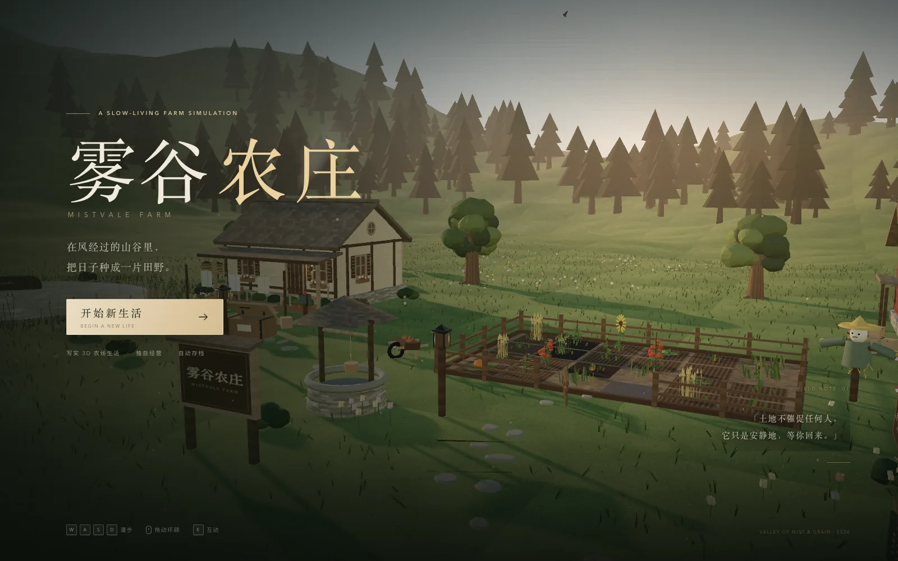
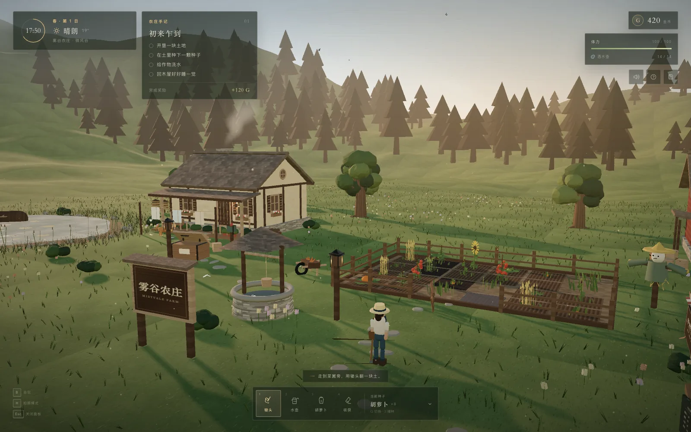

<div align="center">

# 雾谷农庄 · Mistvale Farm

**一款可以直接在浏览器里游玩的写实光影 3D 农场生活游戏。**

[](LICENSE)
[](https://threejs.org/)
[](https://vitejs.dev/)
[](#隐私与素材)



> 在风经过的山谷里，把日子种成一片田野。

</div>

---

## 关于

**雾谷农庄**是一款运行在浏览器中的第三人称 3D 农场生活游戏。你继承了一座被雾气与松林包围的小农庄：开垦菜圃、播下种子、照顾作物，在缓慢流动的昼夜与天气里，把一片荒地慢慢过成家。

游戏使用 **Three.js + Vite** 构建。场景、模型、材质、水面、天空与音效全部由代码实时生成，不依赖外部美术或音频素材。项目名 **Mistvale（雾谷）** 来自山谷里的晨雾与慢生活，仓库名因此定为 `mistvale-farm`。

## 游戏画面



*傍晚的雾谷：松林、木屋、水井与菜圃，风从山谷深处吹来。*

## 游戏特色

- **一块真正需要照料的土地**：24 块菜圃，5 种作物，独立 3D 生长阶段；开垦、播种、浇水、收获、体力与洒水壶都有完整循环。
- **会呼吸的山谷**：黄金时刻、夜色、星空、雨幕、水面波纹、炊烟、飞鸟、蝴蝶与萤火虫；天气会改变光照，雨天也会替你浇灌菜圃。
- **慢节奏的生活循环**：回木屋睡一觉推进一天，恢复体力、让浇水后的作物生长；游戏自动存档，标题页可继续农庄。
- **有来有往的小社区**：谷雨杂货铺、出货箱、信箱、水井、谷仓、鸡舍；可以摸阿麦、捡鸡蛋、挤牛奶，也能在码头坐一会儿。
- **手记与目标**：四段农庄手记任务、金币奖励、背包和作物图鉴，让每天都有一个小小的方向。
- **写实光影与手作质感**：程序化 PBR 材质、低角度暖阳、ACES 色调映射、柔光与长阴影；桌面端与触屏均有完整操作界面。

## 快速开始

需要 **Node.js 18+** 与支持 **WebGL 2** 的现代浏览器。

```bash
# 安装依赖
npm install

# 开发模式
npm run dev
```

打开终端提示的地址，默认是 **http://127.0.0.1:5178/**。

生产构建与本地预览：

```bash
npm run build
npm run preview
```

生产预览默认地址：**http://127.0.0.1:4178/**。

> 无需账号或后端服务；页面加载后完全由本地静态资源驱动，可离线游玩。

## 操作

| 操作 | 键盘 / 鼠标 | 触屏 |
| --- | --- | --- |
| 漫步 | `W` `A` `S` `D` | 左侧虚拟摇杆 |
| 小跑 | `Shift` | 推满摇杆 |
| 环顾 / 缩放 | 按住鼠标拖动 / 滚轮 | 拖动屏幕 |
| 互动、使用农具 | `E` / 鼠标左键 | `E` 互动按钮 |
| 锄头 / 水壶 / 种子 / 收获 | `1` `2` `3` `4` | 点击底部农具栏 |
| 切换种子 | `Q` | 种子选择面板 |
| 背包与作物图鉴 | `B` | 手记按钮 |
| 拍照模式（隐藏 HUD） | `H` | — |
| 声音开关 | `M` | 声音按钮 |
| 关闭面板 | `Esc` | 关闭按钮 |

## 农庄里的一天

1. 用锄头把长草的土地翻松，选择种子播下。
2. 从水井或池塘补满洒水壶，给作物浇水。
3. 走到木屋门口按 `E` 回屋休息；浇过水的作物会在夜里长大。
4. 成熟后按 `E` 收获，去谷雨杂货铺买新种子，或在木屋旁把收成放进出货箱。
5. 看天气、读手记、摸摸阿麦，或者在码头等一轮月亮。没有失败结局，慢一点也没关系。

## 技术实现

| 部分 | 方案 |
| --- | --- |
| 渲染 | Three.js `WebGLRenderer`，PBR 材质、PCF 软阴影、雾、自定义水面着色器 |
| 天空 | Three.js `Sky` 大气散射，昼夜参数驱动太阳高度、色温、环境光与雾色 |
| 后期 | HDR 渲染目标、MSAA、UnrealBloom、ACES 色调映射；CSS 暗角与颗粒 |
| 表面 | 纯 Canvas 程序化贴图：草地、泥土、木纹、石块、灰泥、沥青、招牌等 |
| 性能 | 静态网格按材质合批、`InstancedMesh` 草/花/森林、阴影范围与几何预算控制 |
| 交互 | 第三人称相机与碰撞、按朝向选择菜圃、键盘/鼠标/触屏统一交互层 |
| 声音 | WebAudio 实时合成风声、鸟鸣、雨声、钢琴音景与交互音效 |
| 数据 | 浏览器 `localStorage` 自动存档；无后端、无账号、无遥测 |

桌面端在 1600×1000 分辨率下实测稳定约 60 FPS（Chrome / Apple M3）。项目代码全部为 JavaScript，没有额外的模型、贴图或音频资产需要下载。

## 项目结构

```text
.
├── docs/
│   ├── ART-DIRECTION.md          # 美术方向与性能目标
│   └── screenshots/              # 游戏画面截图（不含个人信息）
├── src/
│   ├── main.js                   # 启动、渲染循环、后期
│   ├── game.js                   # 时间、种植循环、任务、存档、相机
│   ├── world.js                  # 山谷、建筑、植被、动物、天空、天气
│   ├── character.js              # 农夫、农具与动作
│   ├── textures.js               # 程序化 Canvas 材质
│   ├── ui.js                     # HUD、商店、出货、手记、标题界面
│   ├── audio.js                  # WebAudio 环境音与音效
│   ├── data.js                   # 作物、天气与时间数据
│   ├── utils.js                  # 数学、噪声与地形
│   └── style.css                 # 视觉系统与响应式布局
├── index.html
├── package.json
├── LICENSE
└── README.md
```

## 脚本

| 命令 | 作用 |
| --- | --- |
| `npm run dev` | 启动 Vite 开发服务器（端口 5178） |
| `npm run build` | 生成生产构建到 `dist/` |
| `npm run preview` | 本地预览生产构建（端口 4178） |

`main` 分支更新后，GitHub Actions 会自动构建并发布到 GitHub Pages；静态资源使用相对路径，因此同时兼容本地预览与 `username.github.io/mistvale-farm/`。

## 隐私与素材

- 本仓库**不包含个人信息、私人照片或任何用户数据**。`docs/screenshots/` 中仅为游戏界面的产品截图，没有系统桌面、路径、账号或其他隐私信息。
- 运行时**不依赖外部网络请求，不接入分析/追踪，也不需要登录**；存档只保存在浏览器的 `localStorage` 中。
- 所有模型、贴图与音频均由项目代码即时生成，没有引入第三方美术或音频素材。
- `.gitignore` 已排除依赖、构建产物、本地截图、环境变量、密钥与常见个人媒体格式，避免误提交。

## 灵感与声明

本作的节奏与情绪参考了经典农场生活游戏：从照料土地开始，和一个小地方建立关系。实现、场景、角色与声音均为本项目的原创程序化内容。

本项目与任何现有商业农场游戏没有隶属关系，也未使用其代码或素材。

## License

[MIT](LICENSE) © 2026 Mistvale Farm contributors
